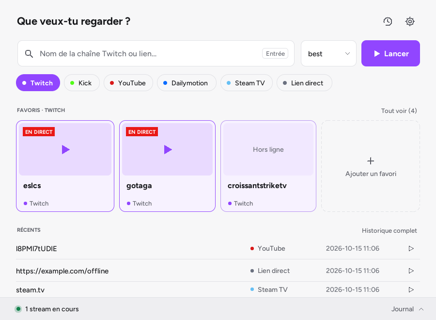
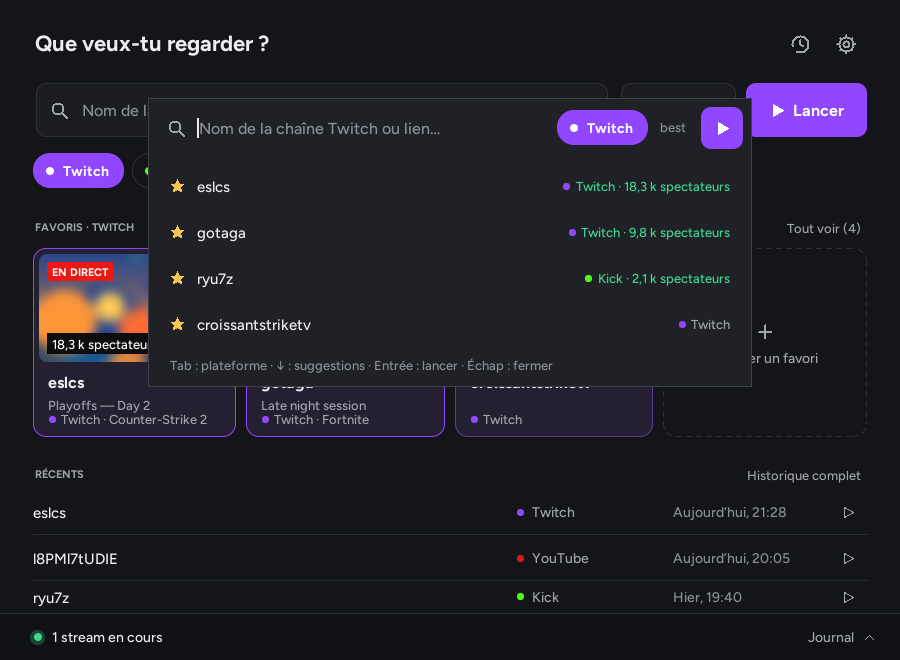
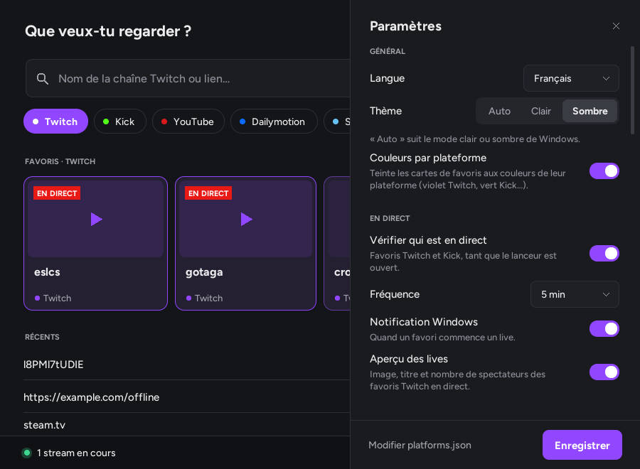

# Streamlink Launcher

**[English](#english) · [Français](#français)**

[](https://github.com/Bulls64/Streamlink-Launcher/releases/latest) 


---

## English

A lightweight Windows and Linux launcher for [Streamlink](https://streamlink.github.io/): paste a link or type a channel name, press <kbd>Enter</kbd>, and the stream opens in your video player (VLC, mpv, PotPlayer…) instead of the browser.

> **New in 1.5.0: Linux AppImage.** One file, no installation, with its own Python: download `StreamlinkLauncher-<version>-x86_64.AppImage` from the [latest release](https://github.com/Bulls64/Streamlink-Launcher/releases/latest), `chmod +x` it and run it. See [Option 2](#option-2-linux-appimage).

Pure Python + Tkinter, **no third-party dependency**. From source, it starts in about 0.25 s and uses around 30 MB of RAM (the single-file `.exe` takes a little longer to start, as it unpacks itself first).

### Features

- **One smart field**: type a channel or paste a link. The platform is detected automatically. Suggestions come from your favorites and history.
- **Platforms**: Twitch (ads disabled), Kick, YouTube, Dailymotion and Steam TV, plus a *Direct link* entry for any site Streamlink supports. Platforms are defined in `platforms.json`, so you can add your own.
- **Quality and player**: quality is remembered per platform (`best`, `1080p60`, `audio_only`, fallback lists such as `720p60,720p,best`). You can choose the player and its arguments.
- **Favorites with live status**: shows which Twitch and Kick favorites are live, with a Windows notification when one goes live. Live Twitch favorites show a preview of the stream, its title and the viewer count (can be turned off). The main screen shows the favorites of the selected platform: click *Kick* to see only your Kick favorites.
- **Smart clipboard and drag and drop**: a copied stream link is offered as soon as you come back to the window (and pre-fills the mini bar). You can also drop a link, text or a `.url` shortcut onto the window.
- **Mini mode**: a floating Spotlight-style bar, opened with <kbd>Ctrl</kbd>+<kbd>Alt</kbd>+<kbd>S</kbd> from any application. The shortcut can be changed in the settings.
- **Notification area**: closing the window keeps it running in the tray, with streams and live checks still active. It can optionally start with Windows.
- **Log drawer**: Streamlink output, running streams and a *Stop* button for each.
- **Updates**: Streamlink update check, and the launcher itself can update from its GitHub releases (Settings → About): download, SHA-256 and signature checks, automatic restart. An optional setting installs updates by itself at start-up.
- **Backup**: export your settings and favorites to a single file and import them on another computer (Settings → Backup).
- **Interface**: light, dark or automatic theme (follows Windows), in English, French, Spanish, German and Italian.

| Light theme | Mini mode | Settings |
|---|---|---|
|  |  |  |

### Requirements

- Windows 10 or 11, or Linux (AppImage, see below). On Linux, the tray icon, global shortcut, start-up option, drag and drop, go-live notifications, preview images and in-app updates are not available.
- [Streamlink](https://streamlink.github.io/install.html) installed. The launcher finds it automatically, or you can set its path in the settings.
- A video player supported by Streamlink (VLC by default).

### Getting started

#### Option 1: executable (no Python needed)

1. Download `StreamlinkLauncher-<version>.exe` from the [latest release](https://github.com/Bulls64/Streamlink-Launcher/releases/latest).
2. Put it in a folder of your choice, for example `Documents\Streamlink`.
3. Double-click it.

The executable is not code-signed (see [Code signing](#code-signing)), so Windows SmartScreen may trigger on the first launch (*"Windows protected your PC"*): click **More info** and then **Run anyway**. To check that the file is the one built by GitHub, compare its SHA-256 with `SHA256SUMS.txt` in the release: `Get-FileHash .\StreamlinkLauncher-<version>.exe` in PowerShell.

#### Option 2: Linux (AppImage)

1. Download `StreamlinkLauncher-<version>-x86_64.AppImage` from the [latest release](https://github.com/Bulls64/Streamlink-Launcher/releases/latest).
2. Make it executable and run it:
   ```sh
   chmod +x StreamlinkLauncher-*-x86_64.AppImage
   ./StreamlinkLauncher-*-x86_64.AppImage
   ```

It includes its own Python and Tcl/Tk, so nothing else is needed besides Streamlink and a player (`sudo apt install streamlink mpv`, `pipx install streamlink`…). It needs glibc 2.35 or newer (Ubuntu 22.04, Debian 12, Fedora 36, Linux Mint 21 or newer). If your system has no FUSE (`libfuse2`), run it with `--appimage-extract-and-run`. Settings and favorites are stored in `~/.config/streamlink-launcher`. To get a menu entry, use a tool such as [Gear Lever](https://flathub.org/apps/it.mijorus.gearlever) or AppImageLauncher. Updates: download the new AppImage from the releases page (the in-app update card opens it).

#### Option 3: from source

Requirements: Python 3.10 or newer, with Tcl/Tk (included by default in the python.org installer). Tested with Python 3.12.

```bat
git clone https://github.com/Bulls64/Streamlink-Launcher.git
cd Streamlink-Launcher
pythonw slink_launcher.py
```

Use `python` instead of `pythonw` if you want to see a console. The `--tray` argument starts the launcher minimized in the notification area.

### Usage

| Action | How |
|---|---|
| Launch a stream | Type a channel or paste a link, then press <kbd>Enter</kbd> or click **Launch** |
| Use a copied link | Come back to the window and click **Launch** in the notification, or open the mini bar: the link is already there |
| Drop a link | Drag it onto the window (address bar, selected text, `.url` file) |
| Choose a suggestion | <kbd>↓</kbd> / <kbd>↑</kbd> then <kbd>Enter</kbd> |
| Mini mode | <kbd>Ctrl</kbd>+<kbd>Alt</kbd>+<kbd>S</kbd> (anywhere). <kbd>Tab</kbd> changes the platform, <kbd>Esc</kbd> closes it |
| Settings | Gear icon, or <kbd>Ctrl</kbd>+<kbd>,</kbd> |
| Close a panel or menu | <kbd>Esc</kbd> |
| Favorite options | Right-click a favorite card |
| Quit | Right-click the tray icon, then **Quit** |

### Configuration and data

All files are stored next to `slink_launcher.py` or the `.exe`. If that folder is read-only (for example `C:\Program Files`), they go to `%APPDATA%\Streamlink Launcher` instead (`~/.config/streamlink-launcher` on Linux, always for the AppImage). *Settings › About* shows where they are.

| File | Content |
|---|---|
| `config.json` | Settings (language, theme, player, live checks, window…) |
| `platforms.json` | Platforms: URL template, Streamlink options, qualities, accent color, live-check method |
| `streams/favorites.json`, `streams/history.json` | Your favorites and history (last 200 launches) |
| `lang/*.json` (`fr`, `en`, `es`, `de`, `it`) | Interface texts. Add a file to add a language |
| `launcher.log` | Error log, useful when reporting a problem |
| `*.bak` | Previous version of each file, used to recover from a damaged file |

Example `platforms.json` entry:

```json
{
  "id": "twitch",
  "name": "Twitch",
  "input": "channel",
  "url": "https://www.twitch.tv/{arg}",
  "hosts": ["twitch.tv"],
  "args": ["--twitch-disable-ads"],
  "qualities": ["best", "1080p60", "720p60", "audio_only"],
  "default_quality": "best",
  "color": "#9146FF",
  "text_color": "#FFFFFF",
  "live_check": "twitch"
}
```

`input` accepts `channel`, `youtube`, `video`, `none` (nothing to type) or `url` (any link). `live_check` accepts `twitch`, `streamlink` or `none`.

### Building the executable

On Windows, with Python installed:

```bat
packaging\build_exe.bat
```

The script installs [PyInstaller](https://pyinstaller.org/) (version pinned in `packaging/requirements-build.txt`) and produces `dist\Streamlink Launcher.exe`: a single file, no console, with the icon and version information embedded.

On GitHub Actions, every pull request builds the executable, and pushing a `v*` tag (for example `v1.4.2`) builds it and publishes it (signing is optional, see [Code signing](#code-signing)) with its `SHA256SUMS.txt`. The CI recompiles PyInstaller's bootloader from source (`BUILD_BOOTLOADER=1`): the prebuilt bootloader is shared by countless programs, including malware, and is the main cause of antivirus false positives.

### Building the AppImage (Linux)

```sh
sudo apt install build-essential libx11-dev libxft-dev libxss-dev libfontconfig-dev patchelf
bash packaging/appimage/build_appimage.sh        # -> dist/StreamlinkLauncher-<version>-x86_64.AppImage
```

The script downloads a standalone Python ([python-build-standalone](https://github.com/astral-sh/python-build-standalone)) and [appimagetool](https://github.com/AppImage/appimagetool), both pinned with their SHA-256, and recompiles Tcl/Tk with Xft (the bundled one only has the basic X11 fonts: no smoothing, no system fonts). The CI builds it on Ubuntu 22.04 for every pull request and attaches it to every release.

### Créer l'AppImage (Linux)

```sh
sudo apt install build-essential libx11-dev libxft-dev libxss-dev libfontconfig-dev patchelf
bash packaging/appimage/build_appimage.sh        # -> dist/StreamlinkLauncher-<version>-x86_64.AppImage
```

Le script télécharge un Python autonome ([python-build-standalone](https://github.com/astral-sh/python-build-standalone)) et [appimagetool](https://github.com/AppImage/appimagetool), tous deux figés avec leur SHA-256, et recompile Tcl/Tk avec Xft (celui fourni n'a que les polices X11 de base : texte non lissé, sans les polices du système). La CI la construit sous Ubuntu 22.04 à chaque pull request et la joint à chaque release.

### Tests

```bat
python -m unittest discover -s tests -v
```

The tests use the standard library only. They run automatically on Windows and Linux at every push.

### Project structure

```
slink_launcher.py      Entry point
launcher/
  app.py               Main window, panels, log drawer
  core.py              Logic without UI: config, platforms, input validation, history, live and update checks
  widgets.py           Lightweight canvas widgets (buttons, pills, cards, fields…)
  theme.py, gfx.py     Colors, fonts, anti-aliased shapes, icons
  mini.py              Mini mode
  thumb.py             Live previews: JPEG decoding (GDI+, ctypes), rounded corners, PNG
  windrop.py           Drag and drop of links onto the window (OLE, ctypes)
  wintray.py           Tray icon, global shortcut, single instance, start with Windows (ctypes)
  winnotify.py         Windows notifications, taskbar flashing
lang/                  Translations
packaging/             Executable build script, version information, winget manifests, AppImage (appimage/)
.signpath/             Code-signing configuration (dormant, see Code signing)
tests/                 Unit tests (standard library only) and GUI smoke test
.github/workflows/     Tests at every push, executable built at every tag
```

### Network and privacy

The launcher only connects to the Internet for:
- **Live checks** (can be turned off): one request to Twitch's public web endpoint for your Twitch favorites, and `streamlink --json` for Kick favorites. This Twitch endpoint is not an official API: if Twitch changes it, live status shows as unknown until an update. With *Live previews* on, the preview image of the live Twitch favorites shown on the main screen (three at most) is downloaded from Twitch's image server at each check.
- **Update check** (can be turned off): one request to [PyPI](https://pypi.org/project/streamlink/) to read the latest Streamlink version, and one to `api.github.com` (`/repos/Bulls64/Streamlink-Launcher/releases/latest`) to read the latest launcher release. The launcher's own file is downloaded from `github.com` only when you click *Update*.

The clipboard is only read, on this computer, to look for a stream link (you can turn this off in the settings); its content is never stored or sent.

Nothing else is sent, and no data is collected.

### Troubleshooting

- **"Streamlink not found"**: install Streamlink, or set the path to `streamlink.exe` in *Settings › Streamlink*.
- **The stream does not start**: open the log drawer at the bottom of the window. Streamlink's error message appears there, for example when the channel is offline.
- **<kbd>Ctrl</kbd>+<kbd>Alt</kbd>+<kbd>S</kbd> does nothing**: another application probably uses this shortcut. The launcher warns you, and *Settings › Window and shortcut* shows its status and lets you pick another one. Each shortcut press received is also written to the log drawer.
- **Antivirus warning on the `.exe`**: PyInstaller executables are sometimes flagged by mistake. Check the SHA-256 against `SHA256SUMS.txt` in the release, report the false positive to your antivirus vendor (for Microsoft Defender: [submit a file](https://www.microsoft.com/wdsi/filesubmission), category *Incorrectly detected as malware*), or run from source instead.
- **Reporting a bug**: attach `launcher.log` (*Settings › About › Open the data folder*) to your [issue](https://github.com/Bulls64/Streamlink-Launcher/issues).

### If Windows blocks the executable

The executable is not code-signed (see [Code signing](#code-signing)), so Windows or your antivirus may object. Nothing here asks you to trust the file blindly: check it first, then unblock it.

1. **Check the file.** Download it only from the [releases page](https://github.com/Bulls64/Streamlink-Launcher/releases) of this repository, then compare its SHA-256 with the one in `SHA256SUMS.txt` (or shown by GitHub next to the file). In PowerShell, from the folder containing the file:
   ```powershell
   Get-FileHash .\StreamlinkLauncher-<version>.exe -Algorithm SHA256
   ```
   The two values must be identical. If they are not, delete the file and do not run it.
2. **SmartScreen ("Windows protected your PC").** Click **More info**, then **Run anyway**. The warning appears because the file is new and unsigned, not because something was detected.
3. **"This file came from another computer" / nothing happens on double-click.** Right-click the file › **Properties** › tick **Unblock** at the bottom of the *General* tab › **OK**. Or in PowerShell: `Unblock-File .\StreamlinkLauncher-<version>.exe`.
4. **The antivirus quarantines or deletes it.** Restore it from the quarantine after checking the SHA-256 (step 1), add the folder containing it to the antivirus exclusions, and report the false positive to the vendor so that it is fixed for everyone (Microsoft Defender: [submit a file](https://www.microsoft.com/wdsi/filesubmission), category *Incorrectly detected as malware*, and mention that it is a PyInstaller program built on GitHub Actions).
5. **Still blocked, or you would rather not trust an unsigned file?** Run it from source (see [Option 3](#option-3-from-source)): the code is the same and nothing has to be unblocked.

Putting the file in a folder of your own (for example `Documents\Streamlink`) rather than a protected one such as `C:\Program Files` also lets the built-in updater replace it.

### Code signing

The Windows executables are **not code-signed**: free signing programs for open source projects require a project size and track record that this one does not have yet. Windows SmartScreen may therefore warn on the first launch (see [Option 1](#option-1-executable-no-python-needed)), and some antivirus programs may flag the file wrongly.

What protects you instead:

- Releases are built by GitHub Actions from this repository's tagged source, never on a personal computer, and each one comes with `SHA256SUMS.txt` (the SHA-256 is also shown in the release notes and by GitHub next to the file).
- The built-in updater only installs the release file of this repository, after checking its size and the SHA-256 published by GitHub.
- The PyInstaller bootloader is compiled from source and UPX is not used, which avoids most false positives.

The release workflow still contains an optional [SignPath](https://about.signpath.io) signing step. It stays off (nothing is signed) unless the `SIGNPATH_ORGANIZATION_ID` variable is set on the repository; the release notes of each version say whether its executable is signed. If one day the executable is signed, the updater will then also require every later version to be signed by the same publisher.

### Credits

Built on top of [Streamlink](https://github.com/streamlink/streamlink). This project is not affiliated with Streamlink, Twitch, Kick, YouTube, Dailymotion or Valve.
This project was inspired by [Streamlink Twitch GUI](https://github.com/streamlink/streamlink-twitch-gui).

License: [MIT](LICENSE)

---

## Français

Un lanceur léger pour Windows et Linux pour [Streamlink](https://streamlink.github.io/) : colle un lien ou tape le nom d'une chaîne, appuie sur <kbd>Entrée</kbd>, et le stream s'ouvre dans ton lecteur vidéo (VLC, mpv, PotPlayer…) au lieu du navigateur.

> **Nouveau en 1.5.0 : AppImage pour Linux.** Un seul fichier, sans installation, avec son propre Python : télécharge `StreamlinkLauncher-<version>-x86_64.AppImage` depuis la [dernière release](https://github.com/Bulls64/Streamlink-Launcher/releases/latest), rends-la exécutable (`chmod +x`) et lance-la. Voir l'[option 2](#option-2--linux-appimage).

Python et Tkinter uniquement, **sans aucune dépendance externe**. Depuis les sources : démarrage en environ 0,25 s, environ 30 Mo de mémoire (l'`.exe` en un seul fichier démarre un peu plus lentement, car il se décompresse d'abord).

### Fonctionnalités

- **Un seul champ intelligent** : tape une chaîne ou colle un lien. La plateforme est reconnue toute seule. Les suggestions viennent de tes favoris et de ton historique.
- **Plateformes** : Twitch (publicités désactivées), Kick, YouTube, Dailymotion et Steam TV, plus une entrée *Lien direct* pour tout site pris en charge par Streamlink. Les plateformes sont définies dans `platforms.json`, tu peux donc ajouter les tiennes.
- **Qualité et lecteur** : la qualité est mémorisée par plateforme (`best`, `1080p60`, `audio_only`, listes de secours comme `720p60,720p,best`). Tu peux choisir le lecteur et ses arguments.
- **Favoris avec statut en direct** : indique lesquels de tes favoris Twitch et Kick sont en direct, avec une notification Windows quand l'un d'eux commence un live. Les favoris Twitch en direct affichent un aperçu du stream, son titre et le nombre de spectateurs (désactivable). L'écran principal affiche les favoris de la plateforme choisie : clique sur *Kick* pour ne voir que tes favoris Kick.
- **Presse-papiers intelligent et glisser-déposer** : un lien de stream copié est proposé dès que tu reviens sur la fenêtre (et pré-remplit la barre mini). Tu peux aussi déposer un lien, du texte ou un raccourci `.url` sur la fenêtre.
- **Mode mini** : une barre flottante façon Spotlight, ouverte avec <kbd>Ctrl</kbd>+<kbd>Alt</kbd>+<kbd>S</kbd> depuis n'importe quelle application. Le raccourci se change dans les Paramètres.
- **Zone de notification** : fermer la fenêtre laisse le lanceur actif à côté de l'horloge, avec les streams et la surveillance des lives. Il peut aussi démarrer avec Windows (option).
- **Tiroir du journal** : sortie de Streamlink, streams en cours et un bouton *Arrêter* pour chacun.
- **Mises à jour** : vérification des mises à jour de Streamlink, et le lanceur peut se mettre à jour lui-même depuis ses releases GitHub (Paramètres → À propos) : téléchargement, contrôle du SHA-256 et de la signature, redémarrage automatique. Un réglage facultatif les installe tout seul au démarrage.
- **Sauvegarde** : exporte tes réglages et tes favoris dans un seul fichier et importe-le sur un autre ordinateur (Paramètres → Sauvegarde).
- **Interface** : thème clair, sombre ou automatique (suit Windows), en français, anglais, espagnol, allemand et italien.

| Thème clair | Mode mini | Paramètres |
|---|---|---|
|  |  |  |

### Prérequis

- Windows 10 ou 11, ou Linux (AppImage, voir plus bas). Sous Linux, l'icône de notification, le raccourci global, le démarrage automatique, le glisser-déposer, les notifications de début de live, les images d'aperçu et la mise à jour intégrée ne sont pas disponibles.
- [Streamlink](https://streamlink.github.io/install.html) installé. Le lanceur le trouve tout seul, ou tu peux indiquer son chemin dans les Paramètres.
- Un lecteur vidéo pris en charge par Streamlink (VLC par défaut).

### Démarrage

#### Option 1 : l'exécutable (sans Python)

1. Télécharge `StreamlinkLauncher-<version>.exe` depuis la [dernière release](https://github.com/Bulls64/Streamlink-Launcher/releases/latest).
2. Place-le dans le dossier de ton choix, par exemple `Documents\Streamlink`.
3. Double-clique dessus.

L'exécutable n'est pas signé (voir [Signature du code](#signature-du-code)), donc Windows SmartScreen peut se déclencher au premier lancement (*« Windows a protégé votre ordinateur »*) : clique sur **Informations complémentaires** puis **Exécuter quand même**. Pour vérifier que le fichier est bien celui compilé par GitHub, compare son SHA-256 avec `SHA256SUMS.txt` dans la release : `Get-FileHash .\StreamlinkLauncher-<version>.exe` dans PowerShell.

#### Option 2 : Linux (AppImage)

1. Télécharge `StreamlinkLauncher-<version>-x86_64.AppImage` depuis la [dernière release](https://github.com/Bulls64/Streamlink-Launcher/releases/latest).
2. Rends-la exécutable et lance-la :
   ```sh
   chmod +x StreamlinkLauncher-*-x86_64.AppImage
   ./StreamlinkLauncher-*-x86_64.AppImage
   ```

Elle embarque son propre Python et Tcl/Tk : il suffit d'avoir Streamlink et un lecteur (`sudo apt install streamlink mpv`, `pipx install streamlink`…). Il faut la glibc 2.35 ou plus récente (Ubuntu 22.04, Debian 12, Fedora 36, Linux Mint 21 ou plus récents). Si ton système n'a pas FUSE (`libfuse2`), lance-la avec `--appimage-extract-and-run`. Les réglages et favoris sont dans `~/.config/streamlink-launcher`. Pour une entrée dans le menu, utilise un outil comme [Gear Lever](https://flathub.org/apps/it.mijorus.gearlever) ou AppImageLauncher. Mises à jour : télécharge la nouvelle AppImage depuis la page des releases (la carte de mise à jour l'ouvre).

#### Option 3 : depuis les sources

Prérequis : Python 3.10 ou plus récent, avec Tcl/Tk (inclus par défaut dans l'installateur de python.org). Testé avec Python 3.12.

```bat
git clone https://github.com/Bulls64/Streamlink-Launcher.git
cd Streamlink-Launcher
pythonw slink_launcher.py
```

Utilise `python` au lieu de `pythonw` si tu veux voir une console. L'argument `--tray` démarre le lanceur réduit dans la zone de notification.

### Utilisation

| Action | Comment |
|---|---|
| Lancer un stream | Tape une chaîne ou colle un lien, puis <kbd>Entrée</kbd> ou **Lancer** |
| Utiliser un lien copié | Reviens sur la fenêtre et clique **Lancer** dans la notification, ou ouvre la barre mini : le lien y est déjà |
| Déposer un lien | Glisse-le sur la fenêtre (barre d'adresse, texte sélectionné, fichier `.url`) |
| Choisir une suggestion | <kbd>↓</kbd> / <kbd>↑</kbd> puis <kbd>Entrée</kbd> |
| Mode mini | <kbd>Ctrl</kbd>+<kbd>Alt</kbd>+<kbd>S</kbd> (partout). <kbd>Tab</kbd> change de plateforme, <kbd>Échap</kbd> ferme |
| Paramètres | Icône engrenage, ou <kbd>Ctrl</kbd>+<kbd>,</kbd> |
| Fermer un panneau ou un menu | <kbd>Échap</kbd> |
| Options d'un favori | Clic droit sur sa carte |
| Quitter | Clic droit sur l'icône de notification, puis **Quitter** |

### Configuration et données

Tous les fichiers sont rangés à côté de `slink_launcher.py` ou du `.exe`. Si ce dossier est protégé en écriture (par exemple `C:\Program Files`), ils vont dans `%APPDATA%\Streamlink Launcher` (`~/.config/streamlink-launcher` sous Linux, toujours pour l'AppImage). *Paramètres › À propos* indique où ils se trouvent.

| Fichier | Contenu |
|---|---|
| `config.json` | Réglages (langue, thème, lecteur, lives, fenêtre…) |
| `platforms.json` | Plateformes : modèle d'URL, options Streamlink, qualités, couleur, méthode de détection du direct |
| `streams/favorites.json`, `streams/history.json` | Tes favoris et ton historique (200 derniers lancements) |
| `lang/*.json` (`fr`, `en`, `es`, `de`, `it`) | Textes de l'interface. Ajoute un fichier pour ajouter une langue |
| `launcher.log` | Journal des erreurs, utile pour signaler un problème |
| `*.bak` | Version précédente de chaque fichier, utilisée pour récupérer un fichier endommagé |

Les champs de `platforms.json` sont décrits dans la partie anglaise ci-dessus (exemple d'entrée Twitch). `input` accepte `channel`, `youtube`, `video`, `none` (rien à saisir) ou `url` (n'importe quel lien). `live_check` accepte `twitch`, `streamlink` ou `none`.

### Créer l'exécutable

Sous Windows, avec Python installé :

```bat
packaging\build_exe.bat
```

Le script installe [PyInstaller](https://pyinstaller.org/) (version figée dans `packaging/requirements-build.txt`) et produit `dist\Streamlink Launcher.exe` : un seul fichier, sans console, avec l'icône et les informations de version intégrées.

Sur GitHub Actions, chaque pull request compile l'exécutable, et pousser un tag `v*` (par exemple `v1.4.2`) le compile et le publie (la signature est facultative, voir [Signature du code](#signature-du-code)) avec son `SHA256SUMS.txt`. La CI recompile le chargeur de PyInstaller depuis ses sources (`BUILD_BOOTLOADER=1`) : le chargeur précompilé est partagé par d'innombrables programmes, malveillants compris, et c'est la première cause de faux positifs antivirus.

### Tests

```bat
python -m unittest discover -s tests -v
```

Les tests n'utilisent que la bibliothèque standard. Ils tournent automatiquement sous Windows et Linux à chaque push.

### Structure du projet

```
slink_launcher.py      Point d'entrée
launcher/
  app.py               Fenêtre principale, panneaux, tiroir du journal
  core.py              Logique sans interface : config, plateformes, validation, historique, lives, mises à jour
  widgets.py           Composants légers dessinés (boutons, pastilles, cartes, champs…)
  theme.py, gfx.py     Couleurs, polices, formes lissées, icônes
  mini.py              Mode mini
  thumb.py             Aperçus des lives : décodage JPEG (GDI+, ctypes), coins arrondis, PNG
  windrop.py           Glisser-déposer de liens sur la fenêtre (OLE, ctypes)
  wintray.py           Icône de notification, raccourci global, instance unique, démarrage avec Windows (ctypes)
  winnotify.py         Notifications Windows, clignotement de la barre des tâches
lang/                  Traductions
packaging/             Script de création de l'exécutable, informations de version, manifestes winget, AppImage (appimage/)
.signpath/             Configuration de signature du code (en sommeil, voir Signature du code)
tests/                 Tests unitaires (bibliothèque standard uniquement) et test de fumée de l'interface
.github/workflows/     Tests à chaque push, exécutable compilé à chaque tag
```

### Réseau et vie privée

Le lanceur ne se connecte à Internet que pour :
- **Le statut en direct** (désactivable) : une requête vers l'accès web public de Twitch pour tes favoris Twitch, et `streamlink --json` pour tes favoris Kick. Cet accès Twitch n'est pas une API officielle : si Twitch le modifie, le statut reste inconnu jusqu'à une mise à jour. Avec *Aperçu des lives* activé, l'image d'aperçu des favoris Twitch en direct affichés sur l'écran principal (trois au plus) est téléchargée depuis le serveur d'images de Twitch à chaque vérification.
- **La vérification des mises à jour** (désactivable) : une requête vers [PyPI](https://pypi.org/project/streamlink/) pour lire la dernière version de Streamlink, et une vers `api.github.com` (`/repos/Bulls64/Streamlink-Launcher/releases/latest`) pour lire la dernière version du lanceur. Le fichier du lanceur n'est téléchargé depuis `github.com` que si tu cliques sur *Mettre à jour*.

Le presse-papiers n'est lu que sur ton ordinateur, pour y chercher un lien de stream (désactivable dans les Paramètres) : son contenu n'est ni enregistré ni envoyé.

Rien d'autre n'est envoyé, et aucune donnée n'est collectée.

### Dépannage

- **« Streamlink introuvable »** : installe Streamlink, ou indique le chemin de `streamlink.exe` dans *Paramètres › Streamlink*.
- **Le stream ne démarre pas** : ouvre le tiroir du journal en bas de la fenêtre. Le message d'erreur de Streamlink s'y affiche, par exemple quand la chaîne est hors ligne.
- **<kbd>Ctrl</kbd>+<kbd>Alt</kbd>+<kbd>S</kbd> ne fait rien** : une autre application utilise sans doute ce raccourci. Le lanceur t'en avertit, et *Paramètres › Fenêtre et raccourci* affiche son état et te permet d'en choisir un autre. Chaque appui reçu est aussi noté dans le tiroir du journal.
- **Alerte antivirus sur le `.exe`** : les exécutables PyInstaller sont parfois détectés à tort. Vérifie le SHA-256 avec `SHA256SUMS.txt` dans la release, signale le faux positif à l'éditeur de l'antivirus (pour Microsoft Defender : [envoyer un fichier](https://www.microsoft.com/wdsi/filesubmission), catégorie *Incorrectly detected as malware*), ou utilise la version source.
- **Signaler un bug** : joins `launcher.log` (*Paramètres › À propos › Ouvrir le dossier des données*) à ton [ticket](https://github.com/Bulls64/Streamlink-Launcher/issues).

### Si Windows bloque l'exécutable

L'exécutable n'est pas signé (voir [Signature du code](#signature-du-code)) : Windows ou ton antivirus peuvent donc faire des difficultés. Rien ici ne te demande de faire confiance les yeux fermés : vérifie le fichier d'abord, débloque-le ensuite.

1. **Vérifie le fichier.** Télécharge-le uniquement depuis la [page des releases](https://github.com/Bulls64/Streamlink-Launcher/releases) de ce dépôt, puis compare son SHA-256 avec celui de `SHA256SUMS.txt` (ou affiché par GitHub à côté du fichier). Dans PowerShell, depuis le dossier du fichier :
   ```powershell
   Get-FileHash .\StreamlinkLauncher-<version>.exe -Algorithm SHA256
   ```
   Les deux valeurs doivent être identiques. Sinon, supprime le fichier et ne le lance pas.
2. **SmartScreen (« Windows a protégé votre ordinateur »).** Clique sur **Informations complémentaires**, puis **Exécuter quand même**. L'avertissement apparaît parce que le fichier est récent et non signé, pas parce que quelque chose a été détecté.
3. **« Ce fichier provient d'un autre ordinateur » / rien ne se passe au double-clic.** Clic droit sur le fichier › **Propriétés** › coche **Débloquer** en bas de l'onglet *Général* › **OK**. Ou dans PowerShell : `Unblock-File .\StreamlinkLauncher-<version>.exe`.
4. **L'antivirus le met en quarantaine ou le supprime.** Restaure-le depuis la quarantaine après avoir vérifié le SHA-256 (étape 1), ajoute le dossier qui le contient aux exclusions de l'antivirus, et signale le faux positif à l'éditeur pour que ce soit corrigé pour tout le monde (Microsoft Defender : [envoyer un fichier](https://www.microsoft.com/wdsi/filesubmission), catégorie *Incorrectly detected as malware*, en précisant qu'il s'agit d'un programme PyInstaller compilé sur GitHub Actions).
5. **Toujours bloqué, ou tu préfères ne pas faire confiance à un fichier non signé ?** Lance-le depuis les sources (voir l'[option 3](#option-3--depuis-les-sources)) : le code est le même et rien n'est à débloquer.

Placer le fichier dans un dossier à toi (par exemple `Documents\Streamlink`) plutôt que dans un dossier protégé comme `C:\Program Files` permet aussi à la mise à jour intégrée de le remplacer.

### Signature du code

Les exécutables Windows ne sont **pas signés** : les programmes gratuits de signature pour l'open source exigent une taille et un historique que ce projet n'a pas encore. Windows SmartScreen peut donc avertir au premier lancement (voir l'[option 1](#option-1--lexécutable-sans-python)), et certains antivirus peuvent détecter le fichier à tort.

Ce qui te protège à la place :

- Les releases sont compilées par GitHub Actions depuis les sources du tag de ce dépôt, jamais sur un ordinateur personnel, et chacune est accompagnée de `SHA256SUMS.txt` (le SHA-256 figure aussi dans les notes de version et chez GitHub à côté du fichier).
- Le programme de mise à jour n'installe que le fichier de release de ce dépôt, après avoir contrôlé sa taille et le SHA-256 publié par GitHub.
- Le chargeur de PyInstaller est compilé depuis ses sources et UPX n'est pas utilisé, ce qui évite l'essentiel des faux positifs.

Le workflow de release contient encore une étape de signature [SignPath](https://about.signpath.io) facultative. Elle reste désactivée (rien n'est signé) tant que la variable `SIGNPATH_ORGANIZATION_ID` n'est pas définie sur le dépôt ; les notes de chaque version indiquent si son exécutable est signé. Si l'exécutable devient un jour signé, le programme de mise à jour exigera ensuite que chaque version suivante le soit par le même éditeur.

### Crédits

Construit autour de [Streamlink](https://github.com/streamlink/streamlink). Ce projet n'est affilié ni à Streamlink, ni à Twitch, Kick, YouTube, Dailymotion ou Valve.
Projet inspiré par [Streamlink Twitch GUI](https://github.com/streamlink/streamlink-twitch-gui).

Licence : [MIT](LICENSE)
