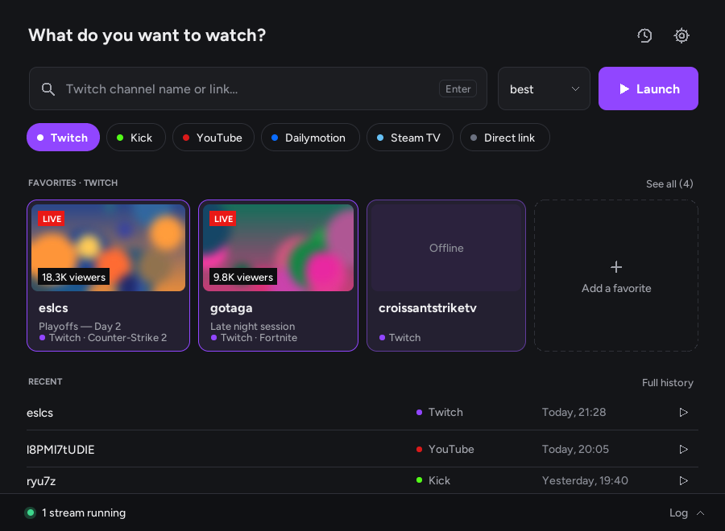
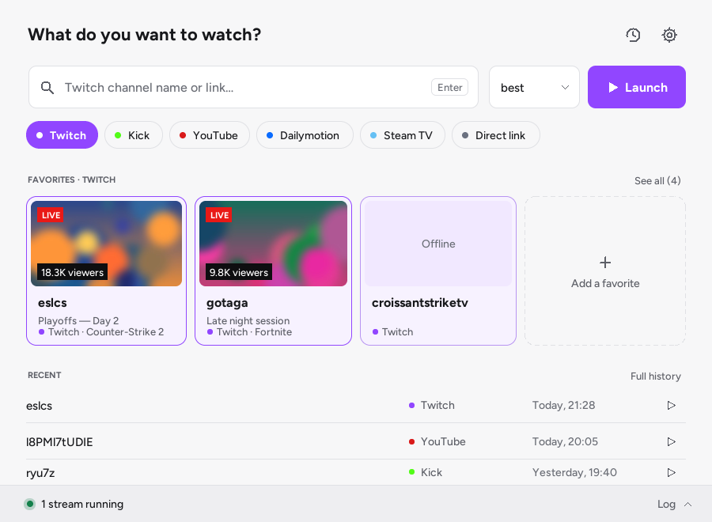
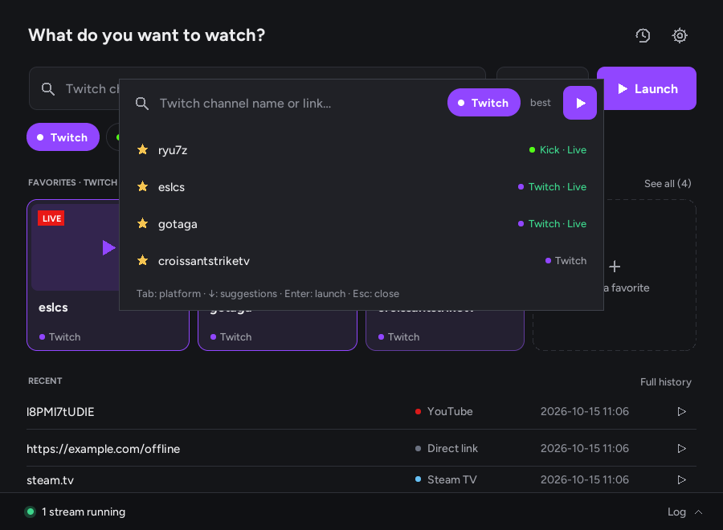
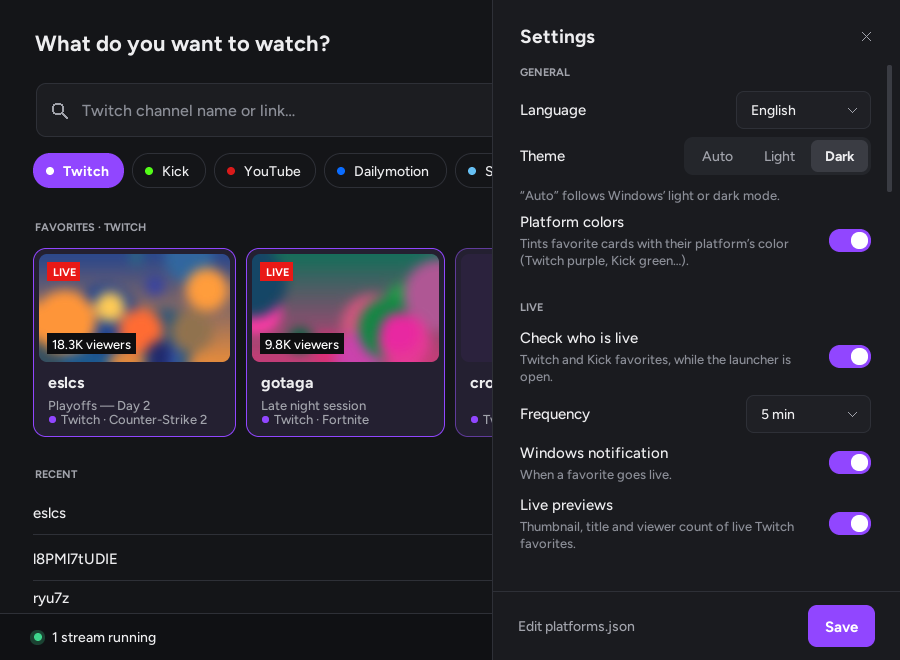

# Streamlink Launcher

**[English](#english) · [Français](#français)**

[](https://github.com/Bulls64/Streamlink-Launcher/releases/latest) 



---

## English

A lightweight Windows launcher for [Streamlink](https://streamlink.github.io/): paste a link or type a channel name, press <kbd>Enter</kbd>, and the stream opens in your video player (VLC, mpv, PotPlayer…) instead of the browser.

Pure Python + Tkinter, **no third-party dependency**. From source, it starts in about 0.25 s and uses around 30 MB of RAM (the single-file `.exe` takes a little longer to start, as it unpacks itself first).

### Features

- **One smart field**: type a channel or paste a link. The platform is detected automatically. Suggestions come from your favorites and history.
- **Platforms**: Twitch (ads disabled), Kick, YouTube, Dailymotion and Steam TV, plus a *Direct link* entry for any site Streamlink supports. Platforms are defined in `platforms.json`, so you can add your own.
- **Quality and player**: quality is remembered per platform (`best`, `1080p60`, `audio_only`, fallback lists such as `720p60,720p,best`). You can choose the player and its arguments.
- **Favorites with live status**: shows which Twitch and Kick favorites are live, with a Windows notification when one goes live. Live Twitch favorites show a preview of the stream, its title and the viewer count (can be turned off). The main screen shows the favorites of the selected platform: click *Kick* to see only your Kick favorites.
- **Smart clipboard and drag and drop**: a copied stream link is offered as soon as you come back to the window (and pre-fills the mini bar). You can also drop a link, text or a `.url` shortcut onto the window.
- **Mini mode**: a floating Spotlight-style bar, opened with <kbd>Ctrl</kbd>+<kbd>Alt</kbd>+<kbd>S</kbd> from any application. The shortcut can be changed in the settings.
- **Notification area**: closing the window keeps it running in the tray, with streams and live checks still active. It can optionally start with Windows.
- **Log drawer**: Streamlink output, running streams and a *Stop* button for each.
- **Streamlink update check**: in the settings and optionally at start-up.
- **Backup**: export your settings and favorites to a single file and import them on another computer (Settings → Backup).
- **Interface**: light, dark or automatic theme (follows Windows), in English, French, Spanish, German and Italian.

| Light theme | Mini mode | Settings |
|---|---|---|
|  |  |  |

### Requirements

- Windows 10 or 11. The interface also runs on Linux, but the tray icon, global shortcut and start-up options are Windows-only.
- [Streamlink](https://streamlink.github.io/install.html) installed. The launcher finds it automatically, or you can set its path in the settings.
- A video player supported by Streamlink (VLC by default).

### Getting started

#### Option 1: executable (no Python needed)

1. Download `StreamlinkLauncher-<version>.exe` from the [latest release](https://github.com/Bulls64/Streamlink-Launcher/releases/latest).
2. Put it in a folder of your choice, for example `Documents\Streamlink`.
3. Double-click it.

The executable is not code-signed. On the first launch, Windows SmartScreen may show *"Windows protected your PC"*. Click **More info** and then **Run anyway**.

#### Option 2: from source

Requirements: Python 3.10 or newer, with Tcl/Tk (included by default in the python.org installer). Tested with Python 3.12.

```bat
git clone https://github.com/Bulls64/Streamlink-Launcher.git
cd Streamlink-Launcher
pythonw slink_launcher.py
```

Use `python` instead of `pythonw` if you want to see a console. The `--tray` argument starts the launcher minimized in the notification area.

### Usage

| Action | How |
|---|---|
| Launch a stream | Type a channel or paste a link, then press <kbd>Enter</kbd> or click **Launch** |
| Use a copied link | Come back to the window and click **Launch** in the notification, or open the mini bar: the link is already there |
| Drop a link | Drag it onto the window (address bar, selected text, `.url` file) |
| Choose a suggestion | <kbd>↓</kbd> / <kbd>↑</kbd> then <kbd>Enter</kbd> |
| Mini mode | <kbd>Ctrl</kbd>+<kbd>Alt</kbd>+<kbd>S</kbd> (anywhere). <kbd>Tab</kbd> changes the platform, <kbd>Esc</kbd> closes it |
| Settings | Gear icon, or <kbd>Ctrl</kbd>+<kbd>,</kbd> |
| Close a panel or menu | <kbd>Esc</kbd> |
| Favorite options | Right-click a favorite card |
| Quit | Right-click the tray icon, then **Quit** |

### Configuration and data

All files are stored next to `slink_launcher.py` or the `.exe`. If that folder is read-only (for example `C:\Program Files`), they go to `%APPDATA%\Streamlink Launcher` instead. *Settings › About* shows where they are.

| File | Content |
|---|---|
| `config.json` | Settings (language, theme, player, live checks, window…) |
| `platforms.json` | Platforms: URL template, Streamlink options, qualities, accent color, live-check method |
| `streams/favorites.json`, `streams/history.json` | Your favorites and history (last 200 launches) |
| `lang/*.json` (`fr`, `en`, `es`, `de`, `it`) | Interface texts. Add a file to add a language |
| `launcher.log` | Error log, useful when reporting a problem |
| `*.bak` | Previous version of each file, used to recover from a damaged file |

Example `platforms.json` entry:

```json
{
  "id": "twitch",
  "name": "Twitch",
  "input": "channel",
  "url": "https://www.twitch.tv/{arg}",
  "hosts": ["twitch.tv"],
  "args": ["--twitch-disable-ads"],
  "qualities": ["best", "1080p60", "720p60", "audio_only"],
  "default_quality": "best",
  "color": "#9146FF",
  "text_color": "#FFFFFF",
  "live_check": "twitch"
}
```

`input` accepts `channel`, `youtube`, `video`, `none` (nothing to type) or `url` (any link). `live_check` accepts `twitch`, `streamlink` or `none`.

### Building the executable

On Windows, with Python installed:

```bat
packaging\build_exe.bat
```

The script installs [PyInstaller](https://pyinstaller.org/) and produces `dist\Streamlink Launcher.exe`: a single file, no console, with the icon and version information embedded.

Pushing a `v*` tag (for example `v1.0.2`) also builds the executable on GitHub Actions and attaches it to the release.

### Tests

```bat
python -m unittest discover -s tests -v
```

The tests use the standard library only. They run automatically on Windows and Linux at every push.

### Project structure

```
slink_launcher.py      Entry point
launcher/
  app.py               Main window, panels, log drawer
  core.py              Logic without UI: config, platforms, input validation, history, live and update checks
  widgets.py           Lightweight canvas widgets (buttons, pills, cards, fields…)
  theme.py, gfx.py     Colors, fonts, anti-aliased shapes, icons
  mini.py              Mini mode
  thumb.py             Live previews: JPEG decoding (GDI+, ctypes), rounded corners, PNG
  windrop.py           Drag and drop of links onto the window (OLE, ctypes)
  wintray.py           Tray icon, global shortcut, single instance, start with Windows (ctypes)
  winnotify.py         Windows notifications, taskbar flashing
lang/                  Translations
packaging/             Executable build script and version information
tests/                 Unit tests (standard library only)
.github/workflows/     Tests at every push, executable built at every tag
```

### Network and privacy

The launcher only connects to the Internet for:
- **Live checks** (can be turned off): one request to Twitch's public web endpoint for your Twitch favorites, and `streamlink --json` for Kick favorites. This Twitch endpoint is not an official API: if Twitch changes it, live status shows as unknown until an update. With *Live previews* on, the preview image of the live Twitch favorites shown on the main screen (three at most) is downloaded from Twitch's image server at each check.
- **Update check** (can be turned off): one request to [PyPI](https://pypi.org/project/streamlink/) to read the latest Streamlink version.

The clipboard is only read, on this computer, to look for a stream link (you can turn this off in the settings); its content is never stored or sent.

Nothing else is sent, and no data is collected.

### Troubleshooting

- **"Streamlink not found"**: install Streamlink, or set the path to `streamlink.exe` in *Settings › Streamlink*.
- **The stream does not start**: open the log drawer at the bottom of the window. Streamlink's error message appears there, for example when the channel is offline.
- **<kbd>Ctrl</kbd>+<kbd>Alt</kbd>+<kbd>S</kbd> does nothing**: another application probably uses this shortcut. The launcher warns you, and *Settings › Window and shortcut* shows its status and lets you pick another one. Each shortcut press received is also written to the log drawer.
- **Antivirus warning on the `.exe`**: this is a common false positive with PyInstaller executables. You can run from source instead.
- **Reporting a bug**: attach `launcher.log` (*Settings › About › Open the data folder*) to your [issue](https://github.com/Bulls64/Streamlink-Launcher/issues).

### Credits

Built on top of [Streamlink](https://github.com/streamlink/streamlink). This project is not affiliated with Streamlink, Twitch, Kick, YouTube, Dailymotion or Valve.
This project was inspired by [Streamlink Twitch GUI](https://github.com/streamlink/streamlink-twitch-gui).

License: [MIT](LICENSE)

---

## Français

Un lanceur Windows léger pour [Streamlink](https://streamlink.github.io/) : colle un lien ou tape le nom d'une chaîne, appuie sur <kbd>Entrée</kbd>, et le stream s'ouvre dans ton lecteur vidéo (VLC, mpv, PotPlayer…) au lieu du navigateur.

Python et Tkinter uniquement, **sans aucune dépendance externe**. Depuis les sources : démarrage en environ 0,25 s, environ 30 Mo de mémoire (l'`.exe` en un seul fichier démarre un peu plus lentement, car il se décompresse d'abord).

### Fonctionnalités

- **Un seul champ intelligent** : tape une chaîne ou colle un lien. La plateforme est reconnue toute seule. Les suggestions viennent de tes favoris et de ton historique.
- **Plateformes** : Twitch (publicités désactivées), Kick, YouTube, Dailymotion et Steam TV, plus une entrée *Lien direct* pour tout site pris en charge par Streamlink. Les plateformes sont définies dans `platforms.json`, tu peux donc ajouter les tiennes.
- **Qualité et lecteur** : la qualité est mémorisée par plateforme (`best`, `1080p60`, `audio_only`, listes de secours comme `720p60,720p,best`). Tu peux choisir le lecteur et ses arguments.
- **Favoris avec statut en direct** : indique lesquels de tes favoris Twitch et Kick sont en direct, avec une notification Windows quand l'un d'eux commence un live. Les favoris Twitch en direct affichent un aperçu du stream, son titre et le nombre de spectateurs (désactivable). L'écran principal affiche les favoris de la plateforme choisie : clique sur *Kick* pour ne voir que tes favoris Kick.
- **Presse-papiers intelligent et glisser-déposer** : un lien de stream copié est proposé dès que tu reviens sur la fenêtre (et pré-remplit la barre mini). Tu peux aussi déposer un lien, du texte ou un raccourci `.url` sur la fenêtre.
- **Mode mini** : une barre flottante façon Spotlight, ouverte avec <kbd>Ctrl</kbd>+<kbd>Alt</kbd>+<kbd>S</kbd> depuis n'importe quelle application. Le raccourci se change dans les Paramètres.
- **Zone de notification** : fermer la fenêtre laisse le lanceur actif à côté de l'horloge, avec les streams et la surveillance des lives. Il peut aussi démarrer avec Windows (option).
- **Tiroir du journal** : sortie de Streamlink, streams en cours et un bouton *Arrêter* pour chacun.
- **Vérification des mises à jour de Streamlink** : dans les réglages, et au démarrage si tu le souhaites.
- **Sauvegarde** : exporte tes réglages et tes favoris dans un seul fichier et importe-le sur un autre ordinateur (Paramètres → Sauvegarde).
- **Interface** : thème clair, sombre ou automatique (suit Windows), en français, anglais, espagnol, allemand et italien.

| Thème clair | Mode mini | Paramètres |
|---|---|---|
|  |  |  |

### Prérequis

- Windows 10 ou 11. L'interface fonctionne aussi sous Linux, mais l'icône de notification, le raccourci global et le démarrage avec Windows sont réservés à Windows.
- [Streamlink](https://streamlink.github.io/install.html) installé. Le lanceur le trouve tout seul, ou tu peux indiquer son chemin dans les Paramètres.
- Un lecteur vidéo pris en charge par Streamlink (VLC par défaut).

### Démarrage

#### Option 1 : l'exécutable (sans Python)

1. Télécharge `StreamlinkLauncher-<version>.exe` depuis la [dernière release](https://github.com/Bulls64/Streamlink-Launcher/releases/latest).
2. Place-le dans le dossier de ton choix, par exemple `Documents\Streamlink`.
3. Double-clique dessus.

L'exécutable n'est pas signé. Au premier lancement, Windows SmartScreen peut afficher *« Windows a protégé votre ordinateur »*. Clique sur **Informations complémentaires** puis **Exécuter quand même**.

#### Option 2 : depuis les sources

Prérequis : Python 3.10 ou plus récent, avec Tcl/Tk (inclus par défaut dans l'installateur de python.org). Testé avec Python 3.12.

```bat
git clone https://github.com/Bulls64/Streamlink-Launcher.git
cd Streamlink-Launcher
pythonw slink_launcher.py
```

Utilise `python` au lieu de `pythonw` si tu veux voir une console. L'argument `--tray` démarre le lanceur réduit dans la zone de notification.

### Utilisation

| Action | Comment |
|---|---|
| Lancer un stream | Tape une chaîne ou colle un lien, puis <kbd>Entrée</kbd> ou **Lancer** |
| Utiliser un lien copié | Reviens sur la fenêtre et clique **Lancer** dans la notification, ou ouvre la barre mini : le lien y est déjà |
| Déposer un lien | Glisse-le sur la fenêtre (barre d'adresse, texte sélectionné, fichier `.url`) |
| Choisir une suggestion | <kbd>↓</kbd> / <kbd>↑</kbd> puis <kbd>Entrée</kbd> |
| Mode mini | <kbd>Ctrl</kbd>+<kbd>Alt</kbd>+<kbd>S</kbd> (partout). <kbd>Tab</kbd> change de plateforme, <kbd>Échap</kbd> ferme |
| Paramètres | Icône engrenage, ou <kbd>Ctrl</kbd>+<kbd>,</kbd> |
| Fermer un panneau ou un menu | <kbd>Échap</kbd> |
| Options d'un favori | Clic droit sur sa carte |
| Quitter | Clic droit sur l'icône de notification, puis **Quitter** |

### Configuration et données

Tous les fichiers sont rangés à côté de `slink_launcher.py` ou du `.exe`. Si ce dossier est protégé en écriture (par exemple `C:\Program Files`), ils vont dans `%APPDATA%\Streamlink Launcher`. *Paramètres › À propos* indique où ils se trouvent.

| Fichier | Contenu |
|---|---|
| `config.json` | Réglages (langue, thème, lecteur, lives, fenêtre…) |
| `platforms.json` | Plateformes : modèle d'URL, options Streamlink, qualités, couleur, méthode de détection du direct |
| `streams/favorites.json`, `streams/history.json` | Tes favoris et ton historique (200 derniers lancements) |
| `lang/*.json` (`fr`, `en`, `es`, `de`, `it`) | Textes de l'interface. Ajoute un fichier pour ajouter une langue |
| `launcher.log` | Journal des erreurs, utile pour signaler un problème |
| `*.bak` | Version précédente de chaque fichier, utilisée pour récupérer un fichier endommagé |

Les champs de `platforms.json` sont décrits dans la partie anglaise ci-dessus (exemple d'entrée Twitch). `input` accepte `channel`, `youtube`, `video`, `none` (rien à saisir) ou `url` (n'importe quel lien). `live_check` accepte `twitch`, `streamlink` ou `none`.

### Créer l'exécutable

Sous Windows, avec Python installé :

```bat
packaging\build_exe.bat
```

Le script installe [PyInstaller](https://pyinstaller.org/) et produit `dist\Streamlink Launcher.exe` : un seul fichier, sans console, avec l'icône et les informations de version intégrées.

Pousser un tag `v*` (par exemple `v1.0.2`) compile aussi l'exécutable sur GitHub Actions et le joint à la release.

### Tests

```bat
python -m unittest discover -s tests -v
```

Les tests n'utilisent que la bibliothèque standard. Ils tournent automatiquement sous Windows et Linux à chaque push.

### Structure du projet

```
slink_launcher.py      Point d'entrée
launcher/
  app.py               Fenêtre principale, panneaux, tiroir du journal
  core.py              Logique sans interface : config, plateformes, validation, historique, lives, mises à jour
  widgets.py           Composants légers dessinés (boutons, pastilles, cartes, champs…)
  theme.py, gfx.py     Couleurs, polices, formes lissées, icônes
  mini.py              Mode mini
  thumb.py             Aperçus des lives : décodage JPEG (GDI+, ctypes), coins arrondis, PNG
  windrop.py           Glisser-déposer de liens sur la fenêtre (OLE, ctypes)
  wintray.py           Icône de notification, raccourci global, instance unique, démarrage avec Windows (ctypes)
  winnotify.py         Notifications Windows, clignotement de la barre des tâches
lang/                  Traductions
packaging/             Script de création de l'exécutable et informations de version
tests/                 Tests unitaires (bibliothèque standard uniquement)
.github/workflows/     Tests à chaque push, exécutable compilé à chaque tag
```

### Réseau et vie privée

Le lanceur ne se connecte à Internet que pour :
- **Le statut en direct** (désactivable) : une requête vers l'accès web public de Twitch pour tes favoris Twitch, et `streamlink --json` pour tes favoris Kick. Cet accès Twitch n'est pas une API officielle : si Twitch le modifie, le statut reste inconnu jusqu'à une mise à jour. Avec *Aperçu des lives* activé, l'image d'aperçu des favoris Twitch en direct affichés sur l'écran principal (trois au plus) est téléchargée depuis le serveur d'images de Twitch à chaque vérification.
- **La vérification des mises à jour** (désactivable) : une requête vers [PyPI](https://pypi.org/project/streamlink/) pour lire la dernière version de Streamlink.

Le presse-papiers n'est lu que sur ton ordinateur, pour y chercher un lien de stream (désactivable dans les Paramètres) : son contenu n'est ni enregistré ni envoyé.

Rien d'autre n'est envoyé, et aucune donnée n'est collectée.

### Dépannage

- **« Streamlink introuvable »** : installe Streamlink, ou indique le chemin de `streamlink.exe` dans *Paramètres › Streamlink*.
- **Le stream ne démarre pas** : ouvre le tiroir du journal en bas de la fenêtre. Le message d'erreur de Streamlink s'y affiche, par exemple quand la chaîne est hors ligne.
- **<kbd>Ctrl</kbd>+<kbd>Alt</kbd>+<kbd>S</kbd> ne fait rien** : une autre application utilise sans doute ce raccourci. Le lanceur t'en avertit, et *Paramètres › Fenêtre et raccourci* affiche son état et te permet d'en choisir un autre. Chaque appui reçu est aussi noté dans le tiroir du journal.
- **Alerte antivirus sur le `.exe`** : c'est un faux positif fréquent avec les exécutables PyInstaller. Tu peux utiliser la version source à la place.
- **Signaler un bug** : joins `launcher.log` (*Paramètres › À propos › Ouvrir le dossier des données*) à ton [ticket](https://github.com/Bulls64/Streamlink-Launcher/issues).

### Crédits

Construit autour de [Streamlink](https://github.com/streamlink/streamlink). Ce projet n'est affilié ni à Streamlink, ni à Twitch, Kick, YouTube, Dailymotion ou Valve.
Projet inspiré par [Streamlink Twitch GUI](https://github.com/streamlink/streamlink-twitch-gui).

Licence : [MIT](LICENSE)
